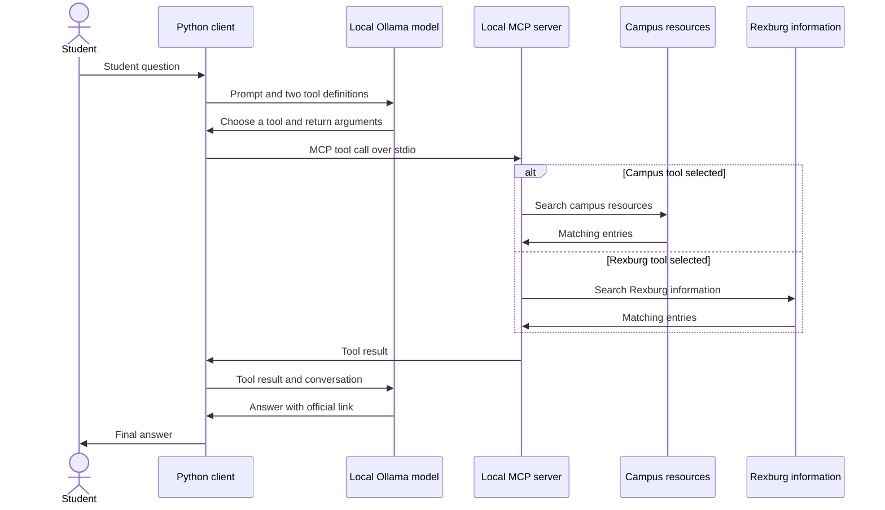
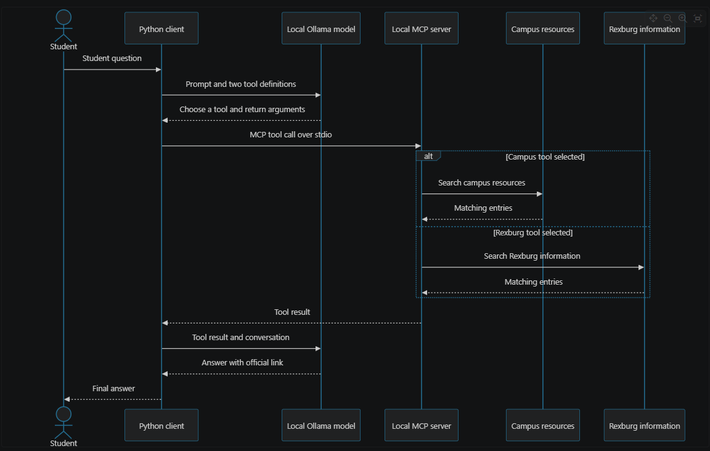

# Lab: Build an MCP Campus Resource Finder

## Goal

Build a local assistant that can find BYU-Idaho student services and City of Rexburg information. You will inspect two small source-linked directories, expose two search functions as MCP tools, connect a client to the MCP server, and let a local language model choose which tool to call. The model runs in Ollama; no API key is needed.

The directories are teaching snapshots compiled from official BYU-Idaho and City of Rexburg pages. Contact information, policies, eligibility, locations, and hours can change. Each entry links to its source; check the official page before relying on details.

## What you will see

<!-- Mermaid source retained for future editing:

-->



The MCP server and client use **stdio**: the client starts the server as a child process and exchanges protocol messages through its input and output streams. Ollama runs in Docker and is reached through a local port. MCP standardizes how the client discovers and calls the server's tool; Ollama handles the separate decision about whether that tool is useful for a question.

## Files

| File | Purpose |
| --- | --- |
| `campus_resources.json` | Small directory of official campus services and source links |
| `rexburg_information.json` | Short, source-linked snapshot of City of Rexburg utilities and parking pages |
| `server.py` | MCP server with `search_campus_resources` and `search_rexburg_information` tools |
| `client.py` | MCP client, local model call, and tool-call routing loop |
| `compose.yaml` | Local Ollama container and persistent model volume |
| `compose.gpu.yaml` | Optional NVIDIA GPU access for the Ollama container |
| `requirements.txt` | Python dependencies |

## Set up

Install Python 3.11 or newer and Docker Desktop (Windows or macOS) or Docker Engine (Linux). The model download is about 2.5 GB, in addition to container and Python dependencies. Allow Docker enough memory for a 4B parameter model; CPU inference works but may be slow.

[Download mcp-campus-resources-lab.zip](../course/data/mcp-campus-resources-lab.zip)

Open a terminal in `mcp-campus-resources`.

Both this lab and `week-4/contextual-retrieval-local` now use the Docker volume `genai-accelerator-ollama-models`. Models downloaded in either lab are available to the other, and `ollama pull` skips models already present. If this is your first setup, continue below. If you already installed an earlier version and want to reuse its downloaded models, copy its old volume into the shared volume **before** starting the updated Compose setup or running `ollama pull`. First list existing volumes with `docker volume ls`, then run the command for each old volume you want to keep:

```bash
docker run --rm -v mcp-campus-resources_ollama_models:/source:ro -v genai-accelerator-ollama-models:/destination alpine:3.21 sh -c "cp -a /source/. /destination/"
```

For an earlier Week 4 install, use its previous volume name instead:

```bash
docker run --rm -v contextual-retrieval-local_contextual_models:/source:ro -v genai-accelerator-ollama-models:/destination alpine:3.21 sh -c "cp -a /source/. /destination/"
```

If you customized a Compose project name, substitute the actual old volume name shown by `docker volume ls`. Keep old volumes until you confirm the shared one works.

**Windows PowerShell:**

```powershell
python -m venv .venv
.\.venv\Scripts\Activate.ps1
python -m pip install -r requirements.txt
docker compose up -d
docker compose exec ollama ollama pull qwen3:4b
```

If PowerShell blocks environment activation, use `\.venv\Scripts\python.exe` in place of `python` in the remaining Python commands.

**macOS/Linux:**

```bash
python3 -m venv .venv
source .venv/bin/activate
python -m pip install -r requirements.txt
docker compose up -d
docker compose exec ollama ollama pull qwen3:4b
```

The container publishes Ollama only on `127.0.0.1:11435`; the Python client uses that same address.

To stop Ollama after working, run `docker compose down` from the lab folder. This stops and removes that lab's container while keeping the shared models on the machine. Start the other lab when you are ready to switch; only run one lab's Ollama container at a time because both use port `11435` and the same model store. Docker also keeps the downloaded container image cached. Avoid `docker compose down -v`: it deletes the shared model volume, so both labs will need to download their models again.

Confirm that the model is available:

```bash
docker compose exec ollama ollama list
```

### Optional: use an NVIDIA GPU

The default setup works on a CPU. If Docker can access a supported NVIDIA GPU, combine the base Compose file with `compose.gpu.yaml` to let Ollama use it. On Windows, Docker Desktop must use its WSL 2 backend, and the NVIDIA driver must support WSL 2 GPU access. On Linux, configure the NVIDIA Container Toolkit for Docker. See [Docker Desktop GPU prerequisites](https://docs.docker.com/desktop/features/gpu/) and [Ollama's Docker instructions](https://docs.ollama.com/docker). This override requests NVIDIA GPUs; it does not configure other GPU types.

After the default setup above, run:

```bash
docker compose -f compose.yaml -f compose.gpu.yaml up -d --wait
```

Compose may recreate the Ollama container to apply the GPU setting. The named model volume is retained. Both CPU and GPU modes use the same local address and port. To switch back to CPU mode, run `docker compose up -d`. When starting Ollama manually after selecting GPU mode, include both files in the command each time; starting with only `compose.yaml` can recreate it without GPU access.

To check whether Ollama is using the GPU, load the model and inspect its processor allocation while it is still loaded:

```bash
docker compose -f compose.yaml -f compose.gpu.yaml exec ollama ollama run qwen3:4b "Say hello in one sentence."
docker compose -f compose.yaml -f compose.gpu.yaml exec ollama ollama ps
```

The `PROCESSOR` column shows the CPU/GPU allocation. An empty list means no model is loaded; run the first command again. If Compose reports that it cannot select an NVIDIA device driver, check the Docker and NVIDIA prerequisites or continue using the CPU setup.

## Walkthrough

### 1. Inspect the resource data

Open `campus_resources.json`. Each record includes a name, category, description, searchable keywords, contact details, and an official source URL. The search tool returns these records so the model can answer from the directory instead of inventing campus details.

Try tracing a few example questions to entries in the JSON:

- “Where can I get help understanding my calculus homework?”
- “My laptop cannot connect to campus Wi-Fi. Who can help?”
- “I want to change my major. Who should I talk to?”
- “Where can I find a transcript?”

The directory intentionally omits a definitive schedule for services whose hours change. The assistant links to official pages for current details.

### 2. Read the MCP server and tools

In `server.py`, `FastMCP` creates a server. The `@mcp.tool()` decorator exposes both `search_campus_resources` and `search_rexburg_information` to MCP clients. Their Python type hints become the tool input schemas, and their docstrings explain what each tool does and what its arguments mean.

Each function loads its local JSON file, scores keyword overlap, and returns the best matches as JSON text. The functions are ordinary Python; MCP provides the standard way for a client to discover and call them. At the bottom, `mcp.run(transport="stdio")` starts the server using stdin and stdout.

### 3. Follow tool discovery in the client

In `client.py`, find `main()`:

1. `StdioServerParameters` tells the MCP client how to run `server.py`.
2. `stdio_client` starts that process and opens the two streams.
3. `ClientSession` initializes the MCP connection.
4. `session.list_tools()` asks the server which tools it exposes. You should see both the campus search and Rexburg search.
5. `tool_specs()` converts the MCP tool names, descriptions, and JSON input schemas into the format Ollama's chat API accepts.

Notice that the client does not hard-code the search tool's parameter schema. It reads it from the MCP server. A different model host could use the same server and tool definition with an adapter for that host's tool format.

### 4. Follow a model-selected tool call

Run the client:

```bash
python client.py
```

Ask one question from each group and watch which tool the model selects:

- **Campus:** “Where can I get help understanding my calculus homework?”
- **Rexburg:** “How do I get a parking permit for streets near campus?”
- **Rexburg:** “How can I pay my water bill?”

The terminal prints `[MCP call]` with the selected tool name and arguments. In `ask()`:

1. The client sends the question and discovered tool definitions to Ollama with `tool_choice` left to the model.
2. If Ollama returns a tool call, the client reads its name and arguments.
3. `session.call_tool(...)` sends that request to the MCP server. Both tools are discovered from MCP, so the client does not need separate hard-coded schemas.
4. The client adds the tool result to the conversation and asks Ollama to produce the student-facing answer.

Try “Tell me a joke” too. The model may answer without calling either search tool. This makes the tool-choice step visible: the model receives two available capabilities, then decides which one fits the request—or whether neither is needed.

### 5. Trace the data and inspect the answer

Ask: “I need help with stress and anxiety. What campus resource can I contact?” Check the printed MCP call, arguments, returned JSON, and final answer. Does the answer link to the Counseling Center? Did it avoid claiming a current appointment slot or unsupported eligibility?

Now ask about a campus or city service missing from the directories. The selected tool should return no matches, and the assistant should say that the directory does not have a match rather than fabricate an office. The client system prompt gives a general BYU-Idaho support contact for missing campus services.

The dataset contains health and counseling links for navigation. The assistant is not a medical or crisis service: the prompt directs emergencies to 911 and after-hours mental health crises to call or text 988.

## Build on the example

The Rexburg data is a compact snapshot, not a live connection to the city website. Its two entries summarize the [City Utilities & Billing page](https://www.rexburg.org/o/cor/page/city-utilities) and the [Rexburg Parking page](https://www.rexburg.org/o/police/page/parking). Policies and contact information can change; check the original page before relying on details.

Pick one small change and make it, then restart the client:

- Add another official BYU-Idaho resource to `campus_resources.json`, including its source URL and useful search keywords.
- Add another Rexburg city topic to `rexburg_information.json`, then see whether `search_rexburg_information` can find it without changes to the client.
- Improve ranking so an exact phrase match in a service name ranks above a broad keyword match.
- Add a second MCP tool, such as `list_resource_categories`, and inspect how the client discovers it without hard-coding it.
- Change the client prompt so the assistant asks a brief follow-up question when the student's need is too vague to search well.

For each change, ask the tool directly through a sample question and check the output against its source page.

## Troubleshooting and cleanup

- **Connection refused:** Check `docker compose ps`, then start the container with `docker compose up -d`.
- **Model not found:** Run `docker compose exec ollama ollama pull qwen3:4b`.
- **Slow answers:** The first prompt can be slower while the model loads. CPU generation can be slow; give the command time to finish.
- **Server messages corrupt the protocol:** MCP stdio uses stdout for protocol messages. Keep debug `print()` calls out of `server.py`; write diagnostics to stderr instead.
- **Resource details look stale:** Follow the entry's `source_url` and refresh the JSON from the official page.

Stop the container with `docker compose down`; the model remains available to both labs. Avoid `docker compose down -v` unless you want to delete the shared Ollama models and download them again for both labs.

## Source pages used for the sample directory

- [Career and Academic Advising](https://www.byui.edu/advising/)
- [Academic Success and Tutoring](https://www.byui.edu/academic-success-and-tutoring/)
- [Walk-Up IT Help Desk](https://td.byui.edu/TDClient/79/ITHelpCenter/KB/Article/13523/The-Walk-Up-IT-Help-Desk)
- [Financial Aid](https://www.byui.edu/financialaid/)
- [Student Health Center services](https://www.byui.edu/health-center/services)
- [Counseling Center](https://www.byui.edu/counseling-center/)
- [Disability Services contact information](https://www.byui.edu/legal/ada)
- [David O. McKay Library](https://library.byui.edu/)
- [Student Records](https://www.byui.edu/student-records/)
- [Campus resources directory](https://www.byui.edu/mentoring/campus-resources)
- [BYU-Idaho office hours](https://www.byui.edu/contact-us/hours)
- [City Utilities & Billing](https://www.rexburg.org/o/cor/page/city-utilities)
- [Rexburg Parking](https://www.rexburg.org/o/police/page/parking)

The source pages were reviewed on **November 19, 2026**. This activity is a learning example, not an official BYU-Idaho or City of Rexburg directory.
